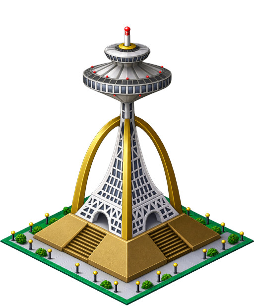

# OpenSC2K HD Graphics

A community graphics pack for [nicholas-ochoa/OpenSC2K](https://github.com/nicholas-ochoa/OpenSC2K), by **udangtang7**.

[한국어](README.ko.md) · [Download the graphics pack](https://github.com/udangtang7/opensc2k-hd/releases/tag/hd-graphics)

| Residential | Utilities | Landmark |
| --- | --- | --- |
|  |  |  |

This repository contains the artwork and its pack manifest: **499 static images, 62 animation strips, and 1,448 sprite bindings**. Engine development and language support are maintained in OpenSC2K.

## Use in OpenSC2K

1. Install OpenSC2K following [its setup instructions](https://github.com/nicholas-ochoa/OpenSC2K#readme), and import your own original SimCity 2000 game resources.
2. Download and extract this graphics pack.
3. In **Settings → Data → HD sprite pack**, browse to **`assets/pack.json`**.
4. Enable **Settings → Graphics → HD graphics**.

Use an OpenSC2K build that provides the **HD sprite pack** setting. Keep the original graphics pack selected in its separate field. This HD pack does not replace the original game resources and contains no game executable, original sprites, music, sounds, or text data.

To turn it off, disable HD graphics or clear the HD sprite pack selection.

## Credits

HD graphics: **udangtang7**, with AI-assisted image generation and subsequent edits. OpenSC2K: Nicholas Ochoa and contributors. This is an unofficial community graphics pack; original names and designs belong to their respective rights holders.

See [ARTWORK-NOTICE.md](ARTWORK-NOTICE.md) for the artwork's license scope. OpenSC2K's code license does not automatically apply to the images in this repository.
